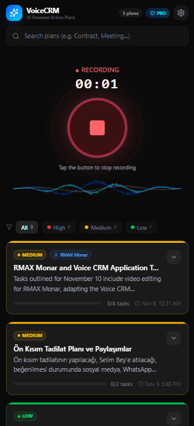
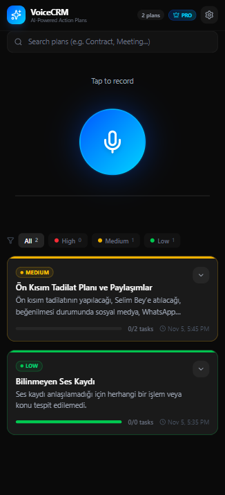
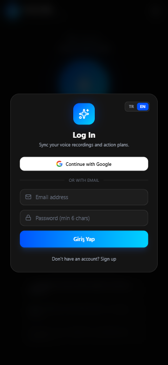
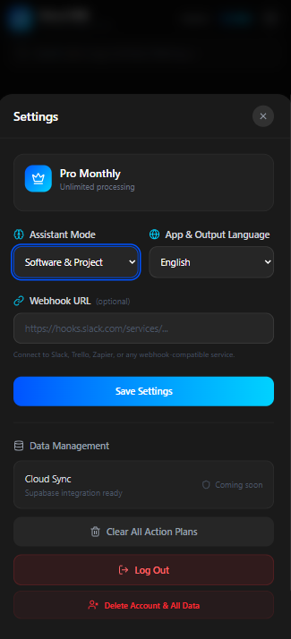

# 🎙️ VoiceCRM - AI-Powered Action Planner

VoiceCRM is an intelligent task management and action planning tool that transcribes voice memos, analyzes intents using Gemini Flash API, and automatically categorizes them into actionable tasks with priorities.

## ✨ Key Features
- **Voice-to-Action Transcription:** Real-time audio recording with live waveform visualization and Gemini AI intent classification.
- **Automated Task Breakdown:** Splits complex audio inputs into structured checklists with due dates and priority tags (High, Medium, Low).
- **Multi-Channel Integrations:** Export and dispatch generated plans directly to **WhatsApp, Telegram, Google Calendar**, or custom **Webhooks (Slack/Zapier)**.
- **Enterprise Settings & Localization:** Multi-language support (TR/EN), customizable assistant modes, and Supabase cloud data management.

## 📸 Screenshots

| AI Recording & Waveform | Task Breakdown & Integrations |
| :---: | :---: |
|  |  |

| Authentication | Integrations & Settings |
| :---: | :---: |
|  |  |

## 🛠️ Tech Stack
- **Front-End:** React 18, TypeScript, Vite, Tailwind CSS, Lucide Icons
- **Back-End / Cloud:** Supabase (PostgreSQL), Webhook Architecture
- **AI Engine:** Google Gemini Flash API

## 🚀 Getting Started

1. Clone the repository:
```bash
git clone https://github.com/oguzhankok/voice-crm-assistant.git
cd voice-crm-assistant
```

2. Install dependencies:
```bash
npm install
```

3. Set up environment variables:
Create a `.env` file in the root directory:
```env
VITE_GEMINI_API_KEY=your_gemini_api_key
VITE_SUPABASE_URL=your_supabase_url
VITE_SUPABASE_ANON_KEY=your_supabase_anon_key
```

4. Run local development server:
```bash
npm run dev
```